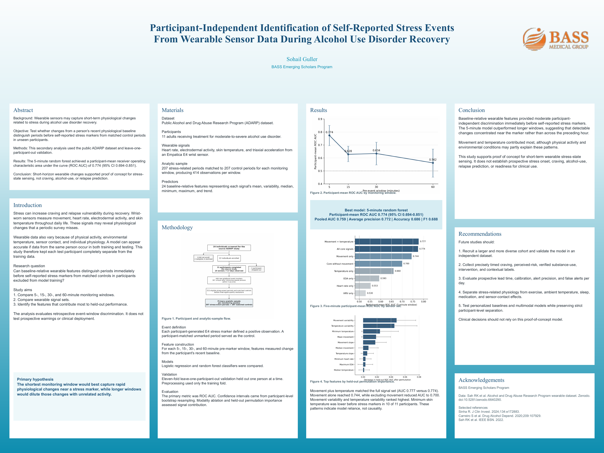

# Wearable Stress-Event Detection in Alcohol Use Disorder Recovery

Code and materials for the paper:

> **Participant-Independent Identification of Self-Reported Stress Events From Wearable Sensor Data During Alcohol Use Disorder Recovery**
> Sohail Guller. BASS Emerging Scholars Program, 2026.
> [Paper](reports/paper.pdf) · [Poster](reports/poster.pdf) · [Analysis notebook](notebooks/ADARP_Analysis.ipynb)



## Overview

Stress is closely tied to craving and relapse risk during recovery from alcohol use disorder (AUD), but self-report only captures it a few times a day. This study asks whether a wrist-worn sensor can pick out the minutes before a person marks a stress event, using only changes from that person's own recent physiological baseline, and whether that works for **people the model has never seen**.

- **Data:** 11 adults in AUD treatment wearing an Empatica E4 in daily life ([ADARP dataset](https://doi.org/10.5281/zenodo.6640290)), with 207 self-marked stress events matched to 207 control periods
- **Features:** 24 change-from-baseline features from movement, skin temperature, heart rate and electrodermal activity, computed over 5, 15, 30 and 60-minute windows
- **Validation:** strict leave-one-participant-out, so every prediction is made on a person whose data never touched training
- **Analyses:** window comparison, sensor-modality ablation, held-out permutation importance, and participant-level bootstrap confidence intervals

**Main result:** a 5-minute random forest reached a participant-mean ROC AUC of **0.774** (95% CI 0.694–0.851) on unseen participants, and every one of the 11 participants scored above chance.

## Results

**Shorter windows worked best.** Participant-mean random forest ROC AUC by pre-event window:

| Window | Participant-mean AUC (95% CI) | Pooled AUC | Average precision |
|---|---|---:|---:|
| **5 min** | **0.774 (0.694–0.851)** | **0.759** | **0.772** |
| 15 min | 0.628 (0.571–0.690) | 0.618 | 0.604 |
| 30 min | 0.634 (0.546–0.721) | 0.616 | 0.616 |
| 60 min | 0.562 (0.452–0.668) | 0.549 | 0.535 |

The 5-minute window beat 15 minutes for 10 of 11 participants and beat 30 and 60 minutes for all 11, which suggests that detectable changes concentrate right before the marker rather than across the preceding hour.

**Movement and temperature carried most of the signal.** Five-minute, participant-mean AUC by sensor set:

| Sensors | AUC |
|---|---:|
| Movement + temperature | 0.777 |
| All core signals | 0.774 |
| Movement only | 0.744 |
| All core signals except movement | 0.700 |
| Temperature only | 0.660 |
| EDA only | 0.593 |
| Heart rate only | 0.553 |

The top held-out predictors were changes in movement variability, temperature variability and minimum skin temperature. Minimum skin temperature dropped before stress markers in 10 of 11 participants.

## Setup

The notebook runs in Google Colab or locally with Python 3.

```sh
pip install -r requirements.txt
```

Download the source data from [Zenodo record 6640290](https://zenodo.org/records/6640290). Locally, put your files in `data/` or point `FEATURE_CSV` at the processed modeling table. In Colab, the notebook mounts Google Drive and reads `MyDrive/ADARP_Project`. `data/`, `raw/` and `runs/` are git-ignored, so participant-level data never gets committed.

## Reproducing results

Open [`notebooks/ADARP_Analysis.ipynb`](notebooks/ADARP_Analysis.ipynb) and run it top to bottom:

1. **Inventory and event tags:** catalogs the sensor files and extracts the E4 stress markers
2. **Input and validation:** loads the processed modeling table and checks its structure
3. **Leave-one-participant-out evaluation:** refits the 5-minute random forest with participant-level bootstrap CIs
4. **Results check:** compares the refit against the reported values

A fresh refit reproduces the paper: participant-mean AUC 0.773870, pooled AUC 0.759178, and CI 0.694033–0.850632. To check a new run's exported summary against the reported numbers:

```sh
python3 tools/check_summary.py /path/to/run/Final_key_statistics.csv
```

[REPRODUCIBILITY.md](REPRODUCIBILITY.md) has the full verification steps.

## Structure

```
notebooks/   analysis notebook (inventory, evaluation, results check, figure export)
reports/     paper and poster (PDF)
results/     reported aggregate results (reported.json)
tools/       check_summary.py, which verifies a run against the reported results
figures/     poster image
requirements.txt
```

## Limitations

This is a retrospective comparison of selected windows in a small sample (11 participants). An unmarked period isn't guaranteed to be stress-free, and movement or the environment may explain part of the signal. The results show proof of concept for short-term stress-state sensing; they don't establish prospective prediction of stress, craving or relapse. The notebook starts from the processed modeling table; the original raw-to-feature pipeline isn't included.

## Citation

```bibtex
@misc{guller2026wearable,
  title  = {Participant-Independent Identification of Self-Reported Stress Events From Wearable Sensor Data During Alcohol Use Disorder Recovery},
  author = {Guller, Sohail},
  year   = {2026},
  note   = {BASS Emerging Scholars Program}
}
```

Please cite the ADARP dataset separately: Sah RK et al. *Alcohol and Drug Abuse Research Program (ADARP) Dataset.* Zenodo, 2022. [doi:10.5281/zenodo.6640290](https://doi.org/10.5281/zenodo.6640290)
